<picture>
  <source media="(prefers-color-scheme: dark)" srcset="https://github.com/ranjeet22/ranjeet22/blob/main/assets/solar-orbits-dark.svg">
  <source media="(prefers-color-scheme: light)" srcset="https://github.com/ranjeet22/ranjeet22/blob/main/assets/solar-orbits-light.svg">
  
</picture>

<picture>
  <source media="(prefers-color-scheme: dark)" srcset="https://github.com/ranjeet22/ranjeet22/blob/main/assets/story-timeline-dark.svg">
  <source media="(prefers-color-scheme: light)" srcset="https://github.com/ranjeet22/ranjeet22/blob/main/assets/story-timeline-light.svg">
  
</picture>

<picture>
  <source media="(prefers-color-scheme: dark)" srcset="https://github.com/ranjeet22/ranjeet22/blob/main/assets/story-rhythm-dark.svg">
  <source media="(prefers-color-scheme: light)" srcset="https://github.com/ranjeet22/ranjeet22/blob/main/assets/story-rhythm-light.svg">
  
</picture>

<picture>
  <source media="(prefers-color-scheme: dark)" srcset="https://github.com/ranjeet22/ranjeet22/blob/main/assets/story-bubbles-dark.svg">
  <source media="(prefers-color-scheme: light)" srcset="https://github.com/ranjeet22/ranjeet22/blob/main/assets/story-bubbles-light.svg">
  
</picture>
